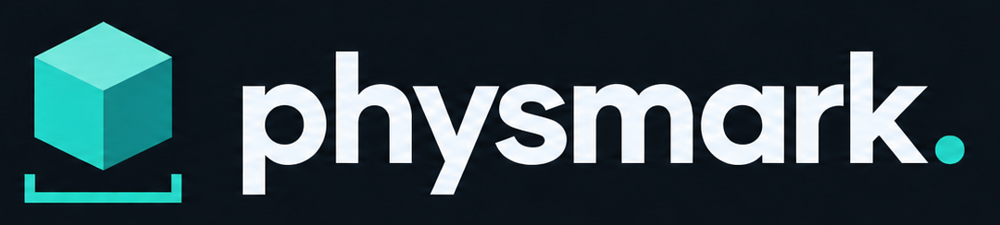

<p align="center">
  
</p>

# PhysMark

A local, source-pinned physics benchmark suite with a Rust controller, seven real engine adapters, shared scenarios, physical sanity checks, and an offline report containing curves, a leaderboard, screenshots and MP4 videos.

| Engine | Default on this Mac | Implementation |
| --- | --- | --- |
| Rapier | CPU | Native Rust, parallel feature enabled; explicit thread budget |
| Nexus | Metal | Native Rust GPU pipeline |
| Genesis | Metal | Genesis rigid solver through Python |
| Newton | CPU | `SolverMuJoCo(use_mujoco_cpu=False)` — MuJoCo Warp even on CPU |
| MuJoCo | CPU | Native library and Python extension built from the pinned source commit |
| MJX | CPU | MuJoCo MJX **JAX** implementation, JIT + `vmap` |
| Isaac | — (CUDA elsewhere) | Isaac Sim 6.1 PhysX 5 GPU dynamics, USD stage built directly; Linux/Windows with an NVIDIA GPU only |

MuJoCo Warp is a pinned Newton dependency, not a separately benchmarked engine. No engine is replaced by a mock or by another solver when its backend is unavailable. An unavailable backend produces a failed trial.

## Quick start

Prerequisites: Git, Rust (the toolchain file selects the tested version), `uv`, CMake, Ninja, and FFmpeg for MP4 generation. Python 3.12 is managed by `uv`. On macOS, Xcode command-line tools and the Metal toolchain are required by Nexus.

```sh
cd ~/work/physmark
cargo run --release -- fetch
cargo run --release -- build
cargo run --release -- doctor
cargo run --release -- run --suite suites/smoke.toml
```

`build` installs into `.physmark/envs/python`, builds the pinned upstream sources in `.physmark/sources`, and compiles the adapters in release mode. It never installs into your system Python. All Python engines share a version-locked environment in this first release; each trial runs in a fresh process. Native adapters have independent Cargo lockfiles.

Open the printed `results/<run>/index.html` directly in a browser. The report works offline and links to all jobs, raw timings, logs, trajectories, settings and source/machine metadata. GPU trials also collect device timestamps in a separate profiling replay when supported: solid curves show synchronized time and dashed curves show GPU time. The coverage table explains unavailable measurements; the leaderboard uses synchronized time. See [timing methodology](docs/methodology.md#gpu-timestamps). Every passing trial also runs an independent memory replay: peak process RAM, macOS physical footprint, and sampled GPU allocations appear in tables and lower-is-better curves. Metal uses actual resource counters for Nexus and Genesis; Apple unified RAM and GPU allocations overlap, so do not add them. Older runs display “not collected”. See [memory methodology](docs/methodology.md#ram-and-gpu-memory). Results and build caches are ignored by Git. No data is uploaded.

```sh
# A scale demonstration with repeated trials and common-renderer videos:
cargo run --release -- run --suite suites/demo.toml

# Brick ring and pyramid walls at 1,000, 10,000 and 28,000 bodies, all six engines:
cargo run --release -- run --suite suites/stacks-three-scales.toml

# The Nexus 110K brick ring and 500K pyramids, each also at the other's scale (no capture):
cargo run --release -- run --suite suites/stacks-large.toml

# Environment scaling: 128/466-body brick structures, 1 to 4,096 environments:
cargo run --release -- run --suite suites/stacks-environments.toml

# All eight features, each with two independent worlds:
cargo run --release -- run --suite suites/coverage.toml

# CPU-only comparison:
cargo run --release -- run --engines rapier,mujoco,mjx,newton,genesis --backend genesis=cpu --no-capture

# Four large single-world scenes: 10,000 bodies, Rapier, five repeats:
cargo run --release -- run --suite suites/large-single-world.toml

# Native batched execution versus serial independent worlds:
cargo run --release -- run --suite suites/batch.toml

# Larger single-world workloads (intentionally demanding):
cargo run --release -- run --suite suites/scale.toml --no-capture

# Small memory telemetry check (eight cases, not a performance study):
cargo run --release -- run --suite suites/memory-smoke.toml

# Rebuild the report without rerunning physics:
cargo run --release -- report results/<run>

# Export an exact scenario:
cargo run --release -- scene mixed_pile --size 32 --seed 42 --output scene.json
```

A run returns a nonzero exit code if any trial fails or is skipped. The report still includes those trials. An existing output directory is never overwritten by a fresh `run`; select another with `--output`.

To continue an interrupted run, repeat its suite/options with `--output results/<run> --resume`. Completed results are preserved, interrupted attempts are archived, and resumed harness provenance is saved in `resume-history.json`. Resumption requires the same suite, engine pins, backends, requested threads, Python package versions, Rust version and machine metadata. A known resource-failing case can be excluded from further attempts with `--skip-case 'mjx:stacks:1024:1=reason'` (engine:scenario:bodies:worlds). These skipped trials remain visible and prevent a complete-suite score. Automatic resource-limit skips are opt-in through the suite’s `skip_after_resource_limit` setting; the full Mac suites enable it. Environment counts run in ascending order, with deterministic shuffled trials within each count. On macOS, set `PHYSMARK_MEMORY_LIMIT_GIB=72` to terminate an adapter if its physical footprint exceeds that limit (sampled once per second by the controller and recorded in provenance).

## Updating engines

`engines.lock` contains full GitHub commit SHAs. MJX deliberately shares MuJoCo's commit. To select a new upstream tag, branch or commit:

```sh
cargo run --release -- pin genesis <tag-or-commit>
cargo run --release -- pin mujoco <tag-or-commit>  # updates MJX as well
cargo run --release -- fetch
cargo run --release -- build
cargo run --release -- run --suite suites/smoke.toml
```

Review and commit the lockfile changes after validation. An upstream API change may require an adapter change; the smoke suite is the compatibility gate. `requirements.lock` pins Python dependency versions. The adapter Cargo lockfiles pin Rust dependencies, including Nexus's Khal and Vortx revisions. Keep native dependency revisions coherent with an updated Nexus pin. Newton, MuJoCo and its Warp dependency may also require coordinated pin updates (`pin mujoco-warp <ref>`). If dependency requirements change, resolve and review the Python lock and Cargo locks explicitly; the build does not silently select a newer engine.

The runner checks source checkouts against the pins and verifies a build fingerprint. Changes to adapters, shared code, build tools or dependency locks require `build` again. Upstream checkout modifications are rejected. Build products are kept outside the upstream trees.

## Scenarios and coverage

All scenes use metres, kilograms, seconds, Z-up, identical explicit mass/inertia, shared initial transforms, gravity and timestep. A scenario is generated once by Rust and serialized for every engine.

| Scenario | Common features exercised |
| --- | --- |
| `free_fall` | Integration, gravity, independent bodies, analytic sanity check |
| `box_pile` | Box collision detection, contact generation and friction |
| `sphere_pile` | Sphere contacts and dense piles |
| `mixed_pile` | Boxes, spheres and capsules with explicit mass properties |
| `stacks` | Persistent contact, stacking and stability |
| `brick_ring` | Running-bond ring wall of bricks smashed by a rolling sphere (the Nexus 110K ring, scaled) |
| `pyramids` | Rows of triangular brick walls smashed by two rolling spheres (the Nexus 500K pyramids, scaled) |
| `dominoes` | Rotational dynamics, contact propagation and slender bodies |
| `pendulums` | Fixed-world revolute constraints and anchor drift |
| `friction_ramp` | Inclined static geometry and frictional contact |

`brick_ring` and `pyramids` are scaled versions of the `brick_ring_110k` and `pyramids_500k` stress scenes on Nexus's `rbd-performance` branch: 1 × 0.5 × 0.5 m bricks of density 1, smashed by spheres rolling in at 30 m/s. Size counts every dynamic body, spheres included. 110,000 reproduces the ring's proportions (radius 80 m, 40 courses, 10 bricks deep); 505,922 reproduces the 16 × 68 walls of 465 bricks. Other sizes rescale the ring radius and course count, or the number of 30-brick walls; the top course or last wall is left partial so the count is exact. The ground top is at z = 0 and gravity is 9.81 m/s², as in every other scene.

Sizes and world counts are independent suite dimensions. Native MuJoCo and Rapier execute worlds serially; MJX uses `vmap`; Nexus, Genesis and Newton use their native batching. The report exposes this distinction. Sleeping/hibernation is disabled everywhere.

Coverage includes rigid primitives, world-anchored hinges, the MJCF robot and single-environment MPM scenes described below. General mesh collision, CCD, ray queries, other deformable solvers and differentiability are not benchmarked. See [methodology](docs/methodology.md) for what the measurements establish and what they do not.

## Single-environment MPM

Three material-point scenes are available: `mpm_elastic_drop` (elastic cube impacting the floor), `mpm_sand_collapse` (granular column collapse), and `mpm_dam_break` (fluid column release in an open tank). These run only on Nexus, Genesis and Newton. Newton selects `SolverImplicitMPM` for MPM; its rigid-body adapter continues to select MuJoCo Warp.

```sh
# Build the MPM-enabled Nexus adapter and refresh the controller fingerprint:
cargo run --release -- build --engines rapier,nexus

# Short MPM integration check, including all three supporting engines:
cargo run --release -- run --suite suites/mpm-smoke.toml

# Particle scaling on this Mac's native GPU backends:
cargo run --release -- run --suite suites/mpm.toml --engines nexus,genesis --threads 8
```

MPM size means **particles**, not rigid bodies. Presets use 512, 4,096, 32,768, 64,000, 110,592 and 195,112 particles (8³ to 58³, the largest even cube under 200K), exactly one environment, 20 substeps per 1/240-second frame, and identical initial points, density, material parameters and cell width across engines. Increasing particle count refines the same physical volume. Supported sizes are even cubes of at least 64 particles. Nexus and Genesis run with CPIC (compatible particle-in-cell rigid coupling) disabled; both adapters assert it after building the scene and Nexus again after the rollout, and record `"cpic": false`. Unsupported engines are excluded from MPM-only runs; mixed rigid/MPM suites and multiple MPM environments are rejected.

The MPM report uses Genesis as its declared baseline, labels particle counts and particle throughput, and retains synchronized/device timing, RAM/GPU memory, scene previews and videos. Engine constitutive laws and numerical grids differ; matching input parameters does not establish equal accuracy. Newton uses a dense grid on CPU and a sparse grid on CUDA. Nexus and Genesis support Metal here; CUDA execution still needs NVIDIA validation. See the MPM section of [methodology](docs/methodology.md).

## NVIDIA machines

The Python adapters accept `--backend genesis=cuda,newton=cuda,mjx=cuda`; Nexus accepts CUDA when built with `PHYSMARK_NEXUS_FEATURES=cuda`. These paths are wired but require validation on NVIDIA hardware. The checked dependency lock was resolved on macOS arm64; a Linux CUDA environment requires compatible CUDA-enabled Torch/Warp/JAX packages and a reviewed platform lock. The build helper accepts `PHYSMARK_NEXUS_FEATURES=webgpu` as well. Linux CUDA memory collection uses NVML per-process counters when the driver exposes them, with explicit unavailable status otherwise. This Mac cannot validate CUDA execution or NVML hardware counters.

## Isaac Sim

The Isaac adapter (`adapters/isaac`) builds each scene directly as a USD stage, runs PhysX 5 TGS with GPU dynamics (`backend=cuda`, the default) or on the CPU (`backend=cpu`), and reads poses through the PhysX tensor API. It supports the rigid primitive scenes, world-anchored hinges and initial velocities; robots and MPM are not wired. Environments are laid out side by side on a grid whose spacing keeps their grounds apart. NVIDIA publishes Isaac Sim wheels for Linux and Windows only, so `build` skips it on macOS and it has not been validated on this Mac.

`engines.lock` records the Isaac Sim 6.1.0 tag commit and the exact wheel (`isaacsim[all,extscache]==6.1.0.0` from `pypi.nvidia.com`). Isaac Sim pins its own Torch and Kit packages, so `build --engines isaac` installs it into a separate `.physmark/envs/isaac` environment. Isaac Sim requires accepting the NVIDIA Omniverse EULA; read it and accept it yourself by exporting `OMNI_KIT_ACCEPT_EULA=YES` before running. The adapter refuses to start otherwise instead of waiting on an interactive prompt.

```sh
cargo run --release -- build --engines isaac,mujoco
cargo run --release -- run --suite suites/isaac-smoke.toml
```

## Development

```sh
cargo fmt --all --check
cargo test --workspace
cargo clippy --workspace --all-targets -- -D warnings
.physmark/envs/python/bin/python -m pytest tests
```

The subprocess protocol and deterministic scene generator live in `crates/physmark-core`; orchestration is in `crates/physmark`; the small Python layer calls the Python-first engines and renders results.

Every engine has its own adapter directory, `adapters/<engine>`: `rapier` and `nexus` are Cargo crates (`physmark-<engine>`); the Python engines have an `<engine>_adapter.py` entry point next to any engine-specific modules (`genesis_mpm.py`, `newton_mpm.py`, Newton's `warp_timing.py`). `adapters/common` holds what they share: `common_rust.rs` (scene construction for both Rapier-based crates), `physmark_adapter.py` (scene-to-MJCF translation, initial velocities and the timed loop), `gpu_timing.py`, `memory_usage.py` and `mpm_common.py`. MJX reuses the MuJoCo adapter's model setup. Python does not orchestrate benchmark scheduling or sit between the controller and a native engine's timed step loop.


### Robotics

Robots are benchmarked standing on the ground only: each one starts crouched with
its feet on the floor and stands under position control, so floor contacts are
always active. Two robots from the pinned
[MuJoCo Menagerie](https://github.com/google-deepmind/mujoco_menagerie/tree/f054586a8e90465d49ee5be15335c4a0c7f57caf)
are available:

| Scenario | Robot | Links | Actuators | Task |
| --- | --- | ---: | ---: | --- |
| `robot_go1` | Unitree Go1 quadruped | 13 | 12 | Stand from a crouch to the MJCF `home` controls |
| `robot_t1` | Booster T1 humanoid | 24 | 23 | Stand from a deeper crouch to `home`; servos stiffened to kp 300, kv 20 |

Rapier, Nexus, MuJoCo and Genesis import the same collision models. The shared
renderer shows their collision primitives. The models' notices are retained in
[docs/licenses/unitree-go1.txt](docs/licenses/unitree-go1.txt) (BSD-3-Clause) and
[docs/licenses/booster-t1.txt](docs/licenses/booster-t1.txt) (Apache-2.0). Keep
them with redistributed robot jobs and reports.

```sh
cargo run --release -- run --suite suites/robot-smoke.toml --threads 8
cargo run --release -- run --suite suites/robot.toml --threads 8
```

`robot.toml` scales both robots from one to 4,096 independent environments, with
one robot per environment. Invalid stand-up runs remain visible but unranked.

Run the complete Mac round, including rigid sizes, brick structures up to 500K
bodies, MPM, brick-structure environment scaling and robot environment scaling,
with eight Rapier workers:

```sh
.physmark/envs/python/bin/python tools/full_mac.py results/full-mac
```

This command assumes the release controller and selected engines have been built.
It automatically generates plots, scene previews, replay videos (except for the
110K/500K brick structures, which are not captured) and the six reports, with a shared landing page at `results/full-mac/index.html`.
Use `--resume` with the same output to
continue an interrupted round. CPU subprocesses have a 120-second budget;
subprocesses exceeding a resource limit cause remaining identical/larger
environment counts of that engine/scene/size to be recorded as skipped. The
110K/500K brick structures use a 600-second CPU budget.

For a resumed full Mac round, optional `skip-cases.json` in the output directory maps
`engine:scenario:size:worlds` to an explicit reason. These exclusions are passed to
the controller and recorded in its resume history and trial outcomes.
